

  <a href="https://directorylab.io">
    <picture>
      <source media="(prefers-color-scheme: dark)" srcset="docs/brand/mark-dark.svg">
      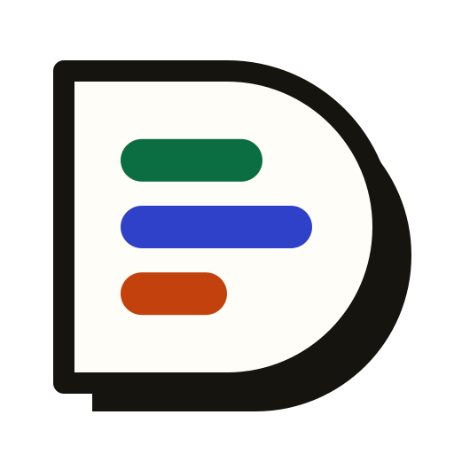
    </picture>
  </a>

<h1 align="center">DirectoryLab</h1>

<strong>Niche site kits that earn for years.</strong>

  <a href="https://directorylab.io">Site</a> ·
  <a href="https://directorylab.io/docs">Docs</a> ·
  <a href="https://directorylab.io/pricing">Pricing</a> ·
  <a href="https://discord.gg/u9HHYwXmF">Discord</a> ·
  <a href="https://x.com/DirectoryLab">X</a> ·
  <a href="https://instagram.com/directory.lab">Instagram</a> ·
  <a href="https://www.youtube.com/@DirectoryLab">YouTube</a>

 

DirectoryLab is three production codebases for niche sites: local directories, job boards and launch platforms. They are the same engines my own sites run on. Each kit is a complete business in a box: the public site, the admin, the payments and the automation. Pick a niche, set it up in the admin, and it is yours to run.

The kits are sold at [directorylab.io](https://directorylab.io). This page is the tour. The [docs](https://directorylab.io/docs) are free to read, and every guide there was written from the code and checked on a fresh copy of each release.

## Three kits. One playbook.

<table>
  <tr>
    <th align="left" width="34%">Kit</th>
    <th align="left">Builds</th>
    <th align="left">Stack</th>
    <th align="left">Links</th>
  </tr>
  <tr>
    <td> <strong>Local Lab</strong></td>
    <td>Local service directories</td>
    <td>Python, Flask, SQLAlchemy, Tailwind</td>
    <td><a href="https://directorylab.io/local-lab">Kit page</a> · <a href="https://directorylab.io/docs/local-lab">Docs</a> · <a href="docs/local-lab.md">Tour</a></td>
  </tr>
  <tr>
    <td> <strong>Job Lab</strong></td>
    <td>Niche job boards</td>
    <td>Next.js 15, TypeScript, Drizzle, PostgreSQL</td>
    <td><a href="https://directorylab.io/job-lab">Kit page</a> · <a href="https://directorylab.io/docs/job-lab">Docs</a> · <a href="docs/job-lab.md">Tour</a></td>
  </tr>
  <tr>
    <td>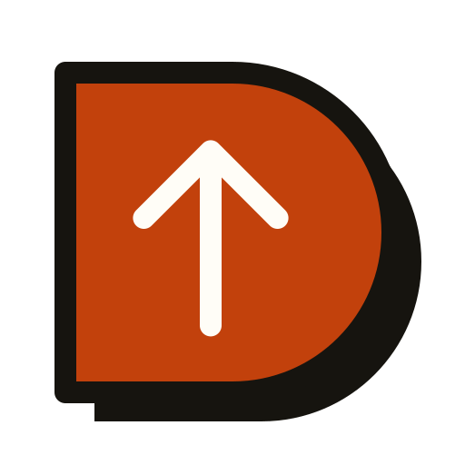 <strong>Launch Lab</strong></td>
    <td>Launch platforms, in the style of Product Hunt</td>
    <td>Python, Flask, SQLAlchemy, Tailwind</td>
    <td><a href="https://directorylab.io/launch-lab">Kit page</a> · <a href="https://directorylab.io/docs/launch-lab">Docs</a> · <a href="docs/launch-lab.md">Tour</a></td>
  </tr>
</table>

Each kit uses the stack that suited the job. Local Lab and Launch Lab are Python and Flask, which makes them cheap to host and easy to move. Job Lab is Next.js with a search engine and a job queue, because pulling in and searching thousands of jobs needs them. The [stack page](https://directorylab.io/stack) lists every part each kit is wired to.

## How a kit becomes a site that earns

1. **Pick a niche.** Choose a market and a domain. The setup wizard turns the kit into that site without touching code.
2. **Fill it.** Import listings, pull in jobs or seed launches. Each kit ships with the tools to populate a site in an afternoon.
3. **Switch on revenue.** Connect Stripe and set your prices in the admin. Featured spots, leads, ads and paid launches are already built.
4. **Run it.** Listings, subscriptions, featured spots and ads pay every month. Keep it, grow it, add the next one.

## Set up in the browser. Works out of the box.

A new install opens on a setup wizard. The admin account, the niche, the brand colour and the prices go in through the browser, and at the end of it the site is running. Nothing is edited in code. The wizard shows once, on a new install; after that the kit is run from its admin.

**Local Lab** asks for the directory and the admin account, then lands on the dashboard. Two steps.

<table>
  <tr>
    <td width="33%"></td>
    <td width="33%"></td>
    <td width="33%"></td>
  </tr>
  <tr>
    <td>The setup wizard, shown once on a new install.</td>
    <td>The second step makes the admin account.</td>
    <td>Quick Actions on the dashboard is the menu for every admin screen.</td>
  </tr>
</table>

<a href="https://directorylab.io/docs/local-lab/install">Install Local Lab →</a>

**Job Lab** starts from a niche. Eleven starter packs set the sources, the filters and the wording, and the wizard fetches the first jobs while you watch.

<table>
  <tr>
    <td width="33%">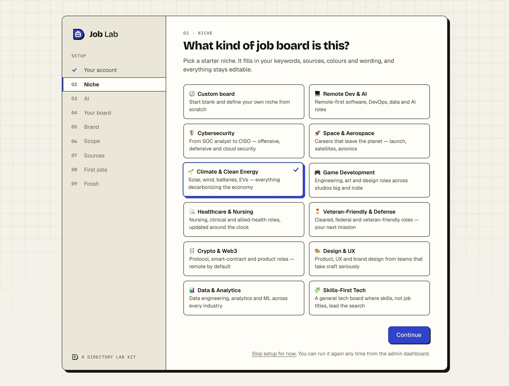</td>
    <td width="33%">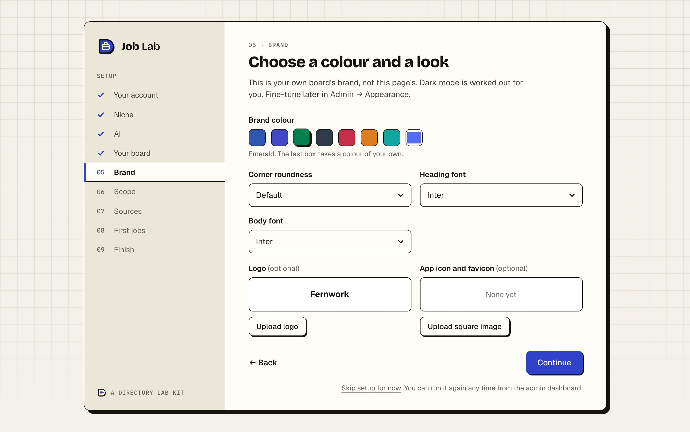</td>
    <td width="33%">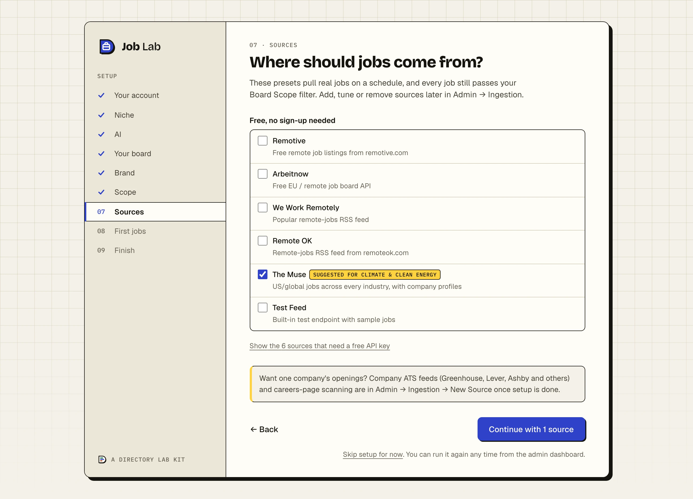</td>
  </tr>
  <tr>
    <td>The setup wizard starts from a niche: eleven starter packs, or a blank board.</td>
    <td>A colour, corners, type and an optional logo. All of it can be changed later.</td>
    <td>Tick the sources to start with. More can be added in the admin.</td>
  </tr>
  <tr>
    <td width="33%">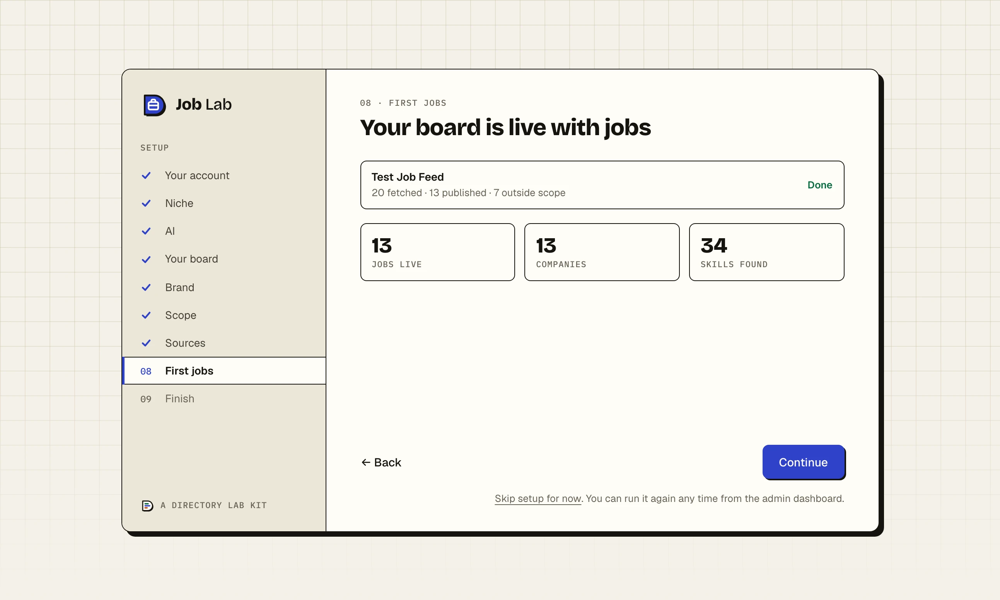</td>
    <td width="33%">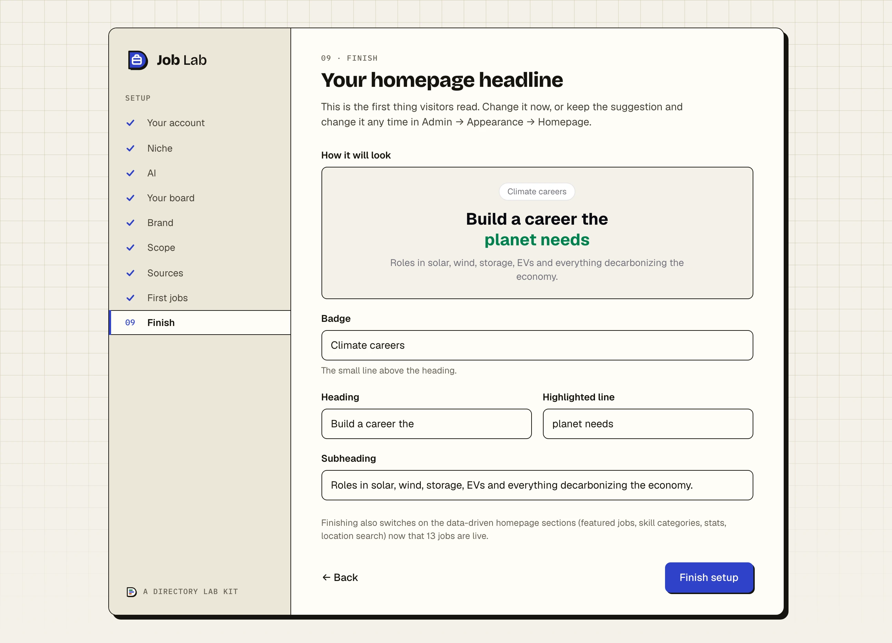</td>
    <td width="33%">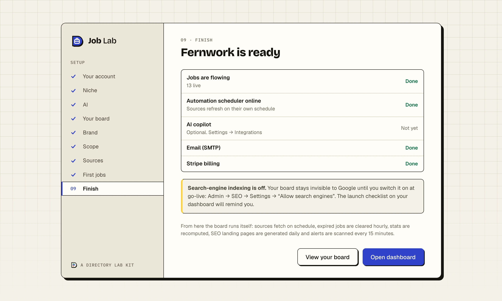</td>
  </tr>
  <tr>
    <td>The wizard fetches from each source while you watch.</td>
    <td>The last step sets the first words a visitor reads.</td>
    <td>Setup ends on a list of what is connected and what is not yet.</td>
  </tr>
</table>

<a href="https://directorylab.io/docs/job-lab/setup-wizard">The Job Lab setup wizard, step by step →</a>

**Launch Lab** takes the account, the site, a colour and a look, the categories, how launches work and what you sell, then reads it all back before it creates the site.

<table>
  <tr>
    <td width="33%">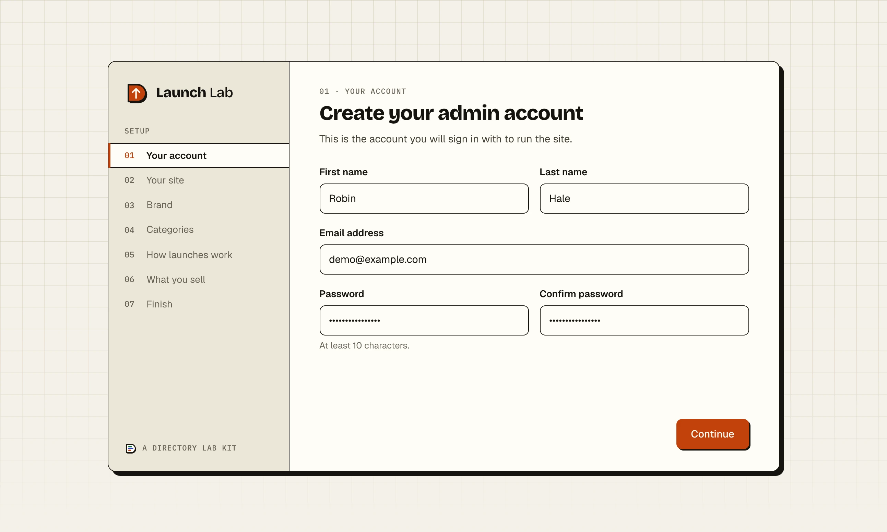</td>
    <td width="33%">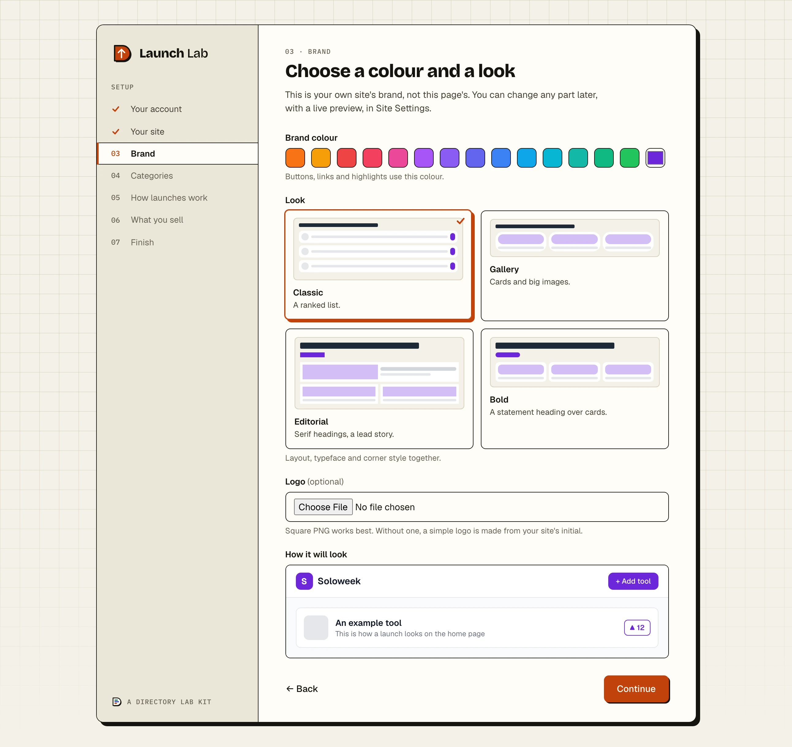</td>
    <td width="33%">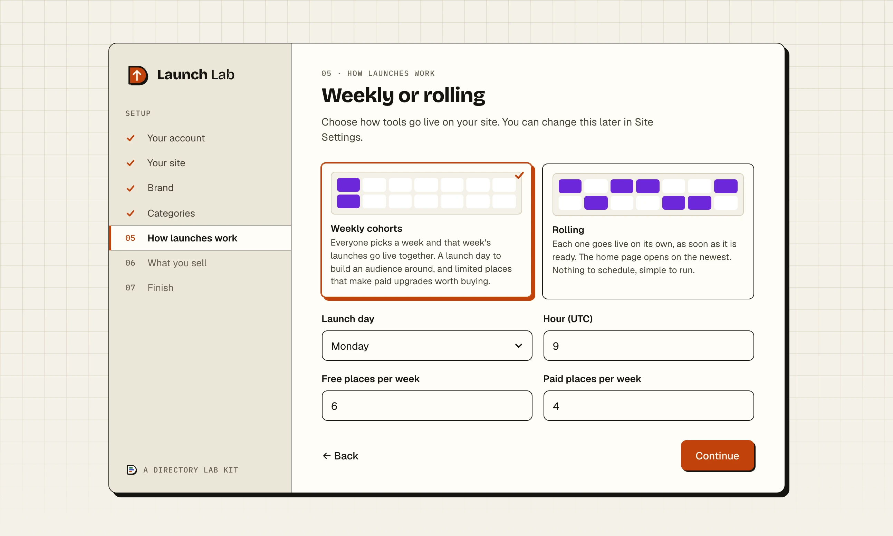</td>
  </tr>
  <tr>
    <td>The setup wizard opens on the admin account. It is shown once, on a new install.</td>
    <td>Pick a colour and a look in the wizard; both can be changed later.</td>
    <td>Choose weekly cohorts or rolling launches, and how many places a week has.</td>
  </tr>
  <tr>
    <td width="33%">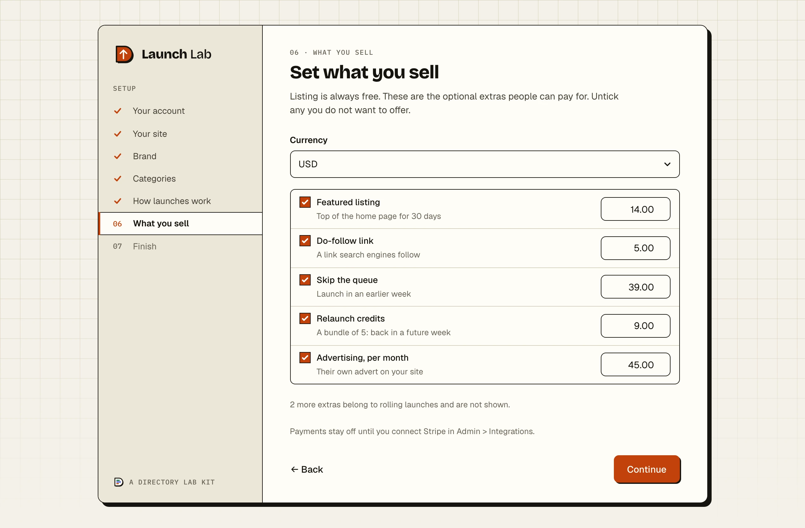</td>
    <td width="33%">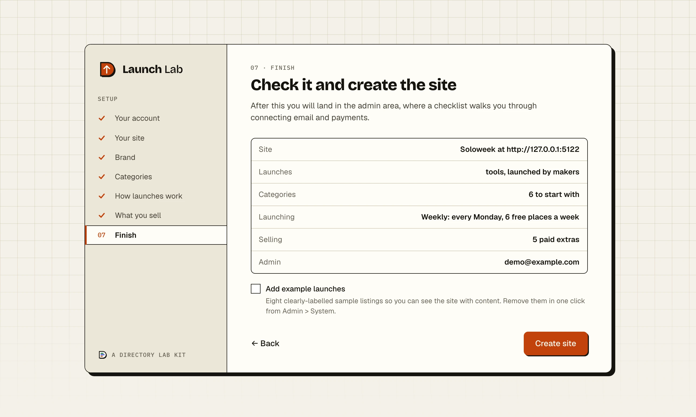</td>
    <td width="33%">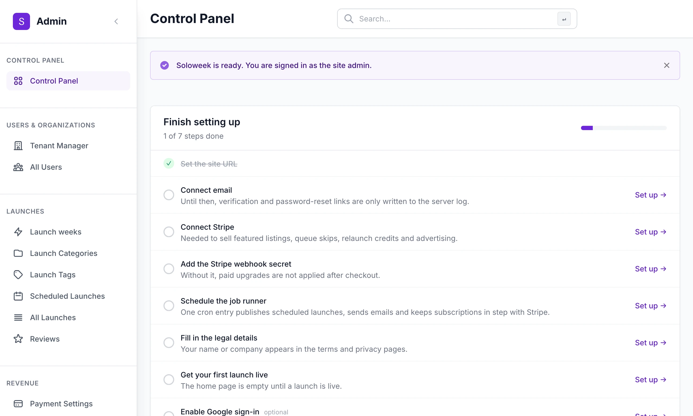</td>
  </tr>
  <tr>
    <td>Tick what you want to sell and set each price.</td>
    <td>The last step reads your choices back before it creates the site.</td>
    <td>A new site lists what is left to set up, with a link to each.</td>
  </tr>
</table>

<a href="https://directorylab.io/docs/launch-lab/setup-wizard">The Launch Lab setup wizard, step by step →</a>

## Local Lab

**Local service directories with the revenue already wired in.** The codebase behind real directories for detailers, locksmiths, roofers, pool cleaners and window cleaners. One install becomes any local niche from the admin panel: import the businesses, set your prices, and every city you add is a new page and a new thing to sell.

Four ways to charge, already built:

- **Lead marketplace.** Customers request quotes for free. Businesses pay monthly per city to receive them, with a limited number of places per city.
- **Homepage featured listings.** One-off or monthly, with limited slots, paid through Stripe and expired automatically.
- **City and category sponsorship.** Businesses pay to appear at the top of their own city or category page.
- **Ad slots.** AdSense placements built into the layouts, so income can start from the first visitor.

<table>
  <tr>
    <td width="50%"></td>
    <td width="50%"></td>
  </tr>
  <tr>
    <td>The home page of a directory built with Local Lab.</td>
    <td>The admin dashboard.</td>
  </tr>
</table>

Read the guides: [Install](https://directorylab.io/docs/local-lab/install) · [Google Places](https://directorylab.io/docs/local-lab/google-places-scraper) · [Import a CSV](https://directorylab.io/docs/local-lab/import-csv) · [Connect Stripe](https://directorylab.io/docs/local-lab/stripe-setup) · [Featured listings](https://directorylab.io/docs/local-lab/featured-listings) · [Sell leads](https://directorylab.io/docs/local-lab/sell-leads) · [Deploy](https://directorylab.io/docs/local-lab/deploy) · [all 23 guides](https://directorylab.io/docs/local-lab)

Built with it: [mobiledetailing.io](https://mobiledetailing.io) · [usalocksmith.io](https://usalocksmith.io) · [windowcleaners.io](https://www.windowcleaners.io) · [usaroofers.io](https://usaroofers.io) · [poolcleaners.io](https://poolcleaners.io)

<a href="docs/local-lab.md">The full Local Lab tour →</a>

## Job Lab

**A niche job board that fills itself and runs itself.** Jobs arrive from feeds, job APIs and company hiring systems, filtered to your niche with the duplicates removed. A weekly newsletter assembles itself with sponsor slots. The AI tidies skills, roles and companies against a monthly cap. It runs devremotely.com and skillfinder.io today.

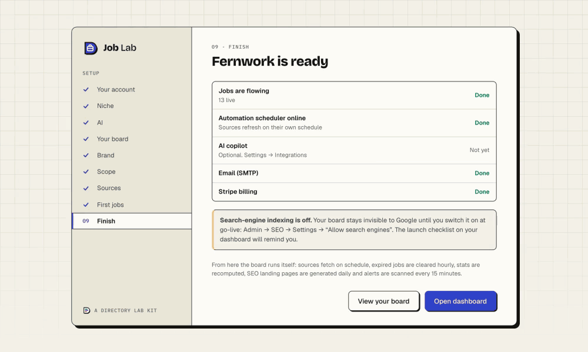

Four ways to charge, already built:

- **Featured jobs and credit bundles.** Employers feature a listing for a fixed period, one-off or as a bundle of credits, through Stripe.
- **Employer plans.** Recurring plans with prices set in the admin and synced to Stripe.
- **Self-serve ad shop.** Sponsors book, pay, and wait for your approval. Rejected orders are refunded automatically.
- **Newsletter sponsorship.** Sell slots in the weekly email alongside site placements.

<table>
  <tr>
    <td width="50%">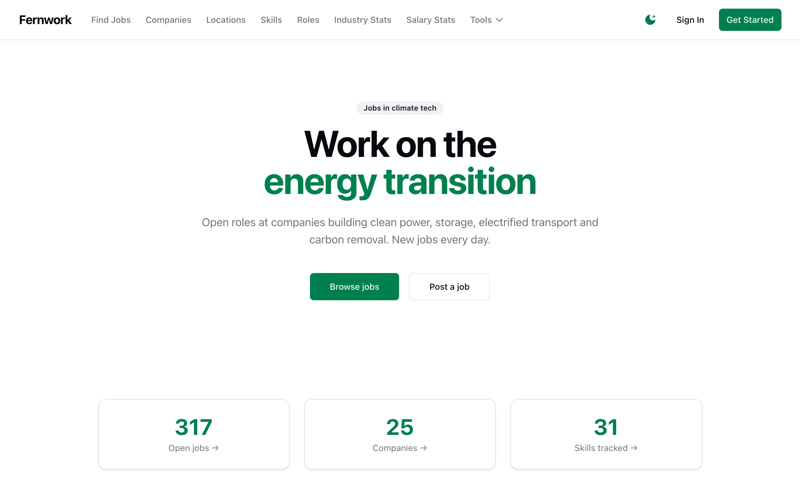</td>
    <td width="50%">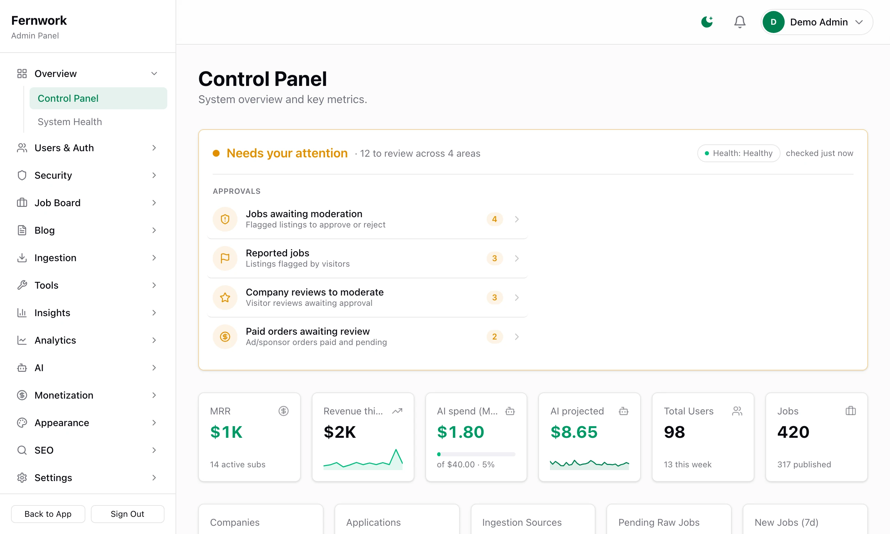</td>
  </tr>
  <tr>
    <td>The home page of a job board built with Job Lab.</td>
    <td>The admin control panel.</td>
  </tr>
</table>

Read the guides: [Install](https://directorylab.io/docs/job-lab/install) · [Setup wizard](https://directorylab.io/docs/job-lab/setup-wizard) · [Job sources](https://directorylab.io/docs/job-lab/job-sources) · [Connect Stripe](https://directorylab.io/docs/job-lab/stripe-setup) · [Employer plans](https://directorylab.io/docs/job-lab/employer-plans) · [Newsletter](https://directorylab.io/docs/job-lab/newsletter) · [Deploy](https://directorylab.io/docs/job-lab/deploy) · [all 25 guides](https://directorylab.io/docs/job-lab)

Built with it: [devremotely.com](https://devremotely.com) · [skillfinder.io](https://skillfinder.io)

<a href="docs/job-lab.md">The full Job Lab tour →</a>

## Launch Lab

**A weekly launch platform for any niche, in the style of Product Hunt.** You set the launch day, the hour, and how many free and paid places each week has. Makers list a product, pick a week, share it and watch the votes. One brand colour in the admin generates the whole palette.

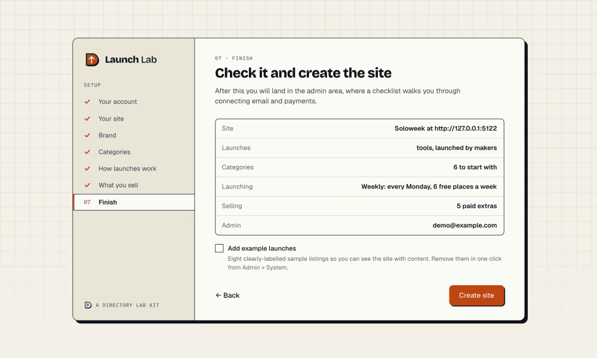

Four ways to charge, already built:

- **Skip the queue.** Makers pay to launch in the week they want instead of waiting for a free place.
- **Featured listings.** A limited number of featured positions, sold for a fixed period.
- **Advertising.** Sponsor placements with their own editor and stats.
- **Links and relaunches.** Paid do-follow links and relaunch credit bundles, with vouchers and refunds handled in the admin.

<table>
  <tr>
    <td width="50%">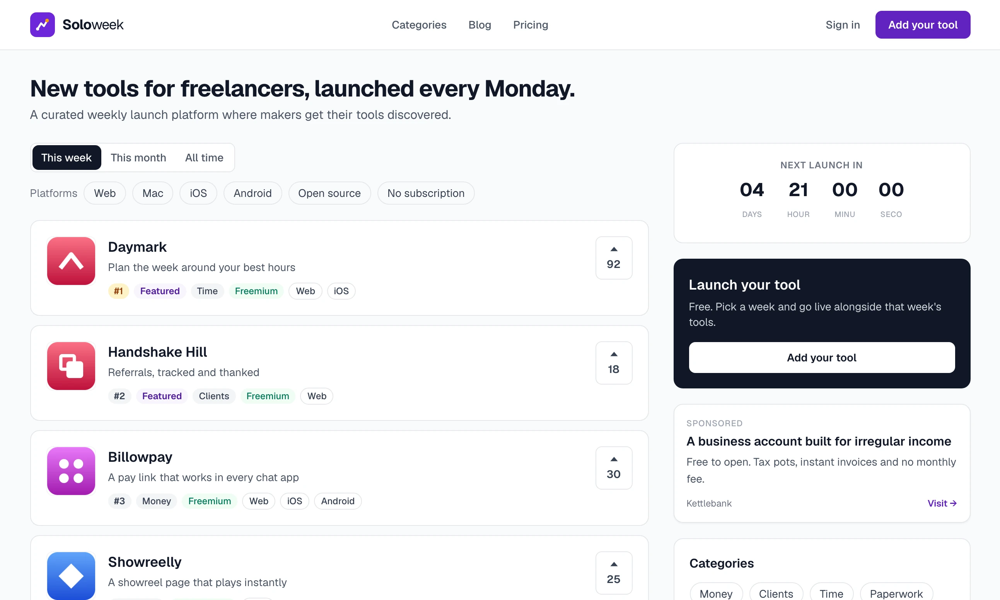</td>
    <td width="50%">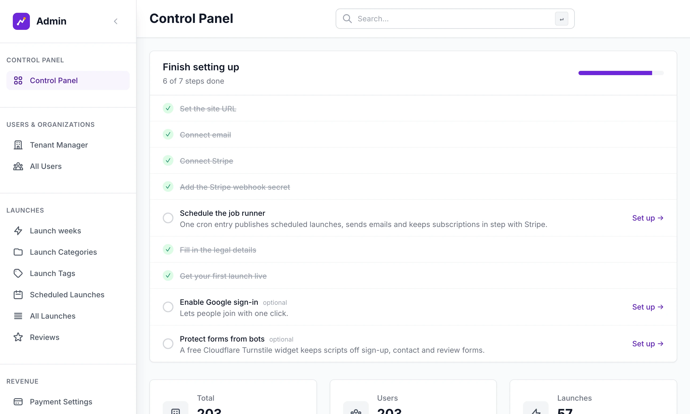</td>
  </tr>
  <tr>
    <td>The home page of a launch site built with Launch Lab.</td>
    <td>The admin control panel.</td>
  </tr>
</table>

Read the guides: [Install](https://directorylab.io/docs/launch-lab/install) · [Setup wizard](https://directorylab.io/docs/launch-lab/setup-wizard) · [Niche packs](https://directorylab.io/docs/launch-lab/niche-packs) · [Connect Stripe](https://directorylab.io/docs/launch-lab/stripe-setup) · [Products and prices](https://directorylab.io/docs/launch-lab/prices) · [Opening day](https://directorylab.io/docs/launch-lab/opening-day) · [Deploy](https://directorylab.io/docs/launch-lab/deploy) · [all 24 guides](https://directorylab.io/docs/launch-lab)

Built with it: [wireweek.io](https://wireweek.io) · [applauncher.io](https://www.applauncher.io) · [biolaunch.io](https://biolaunch.io) · [agentweek.io](https://agentweek.io) · [appsforstores.com](https://appsforstores.com)

<a href="docs/launch-lab.md">The full Launch Lab tour →</a>

## Wired into all three

The integrations and plumbing that eat the first week of any build are done, tested and running on the sites below: **Tailwind CSS**, **Stripe**, **email** over any SMTP server, **PostgreSQL**, **Docker**, **Telegram** and **Google Analytics**. Each kit page lists its full parts tray, down to the number of migrations and emails. See [the stack behind each kit](https://directorylab.io/stack).

## The sites

A few I have built with these kits. It is the same code you get, pointed at a different niche each time.

<table>
  <tr>
    <td width="33%"><a href="https://mobiledetailing.io">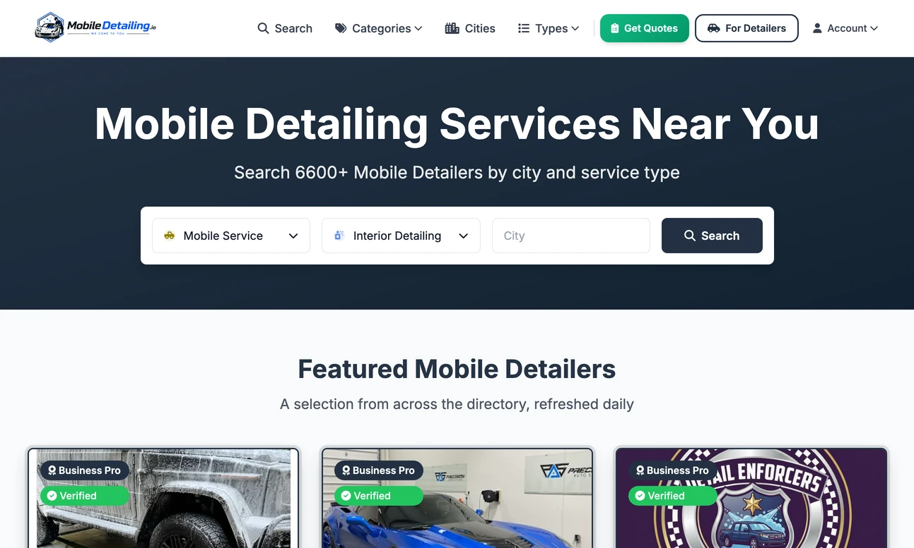</a></td>
    <td width="33%"><a href="https://usalocksmith.io">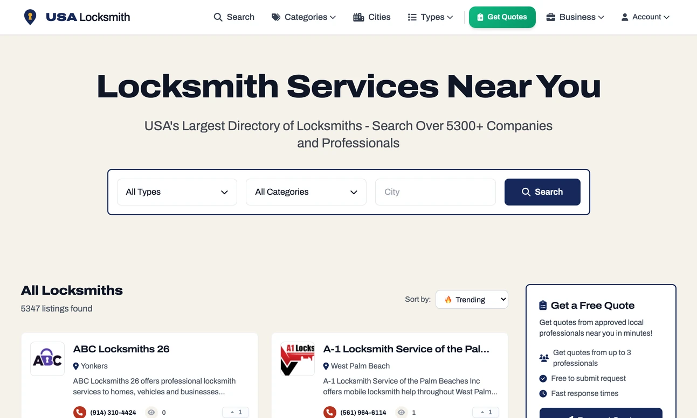</a></td>
    <td width="33%"><a href="https://www.windowcleaners.io">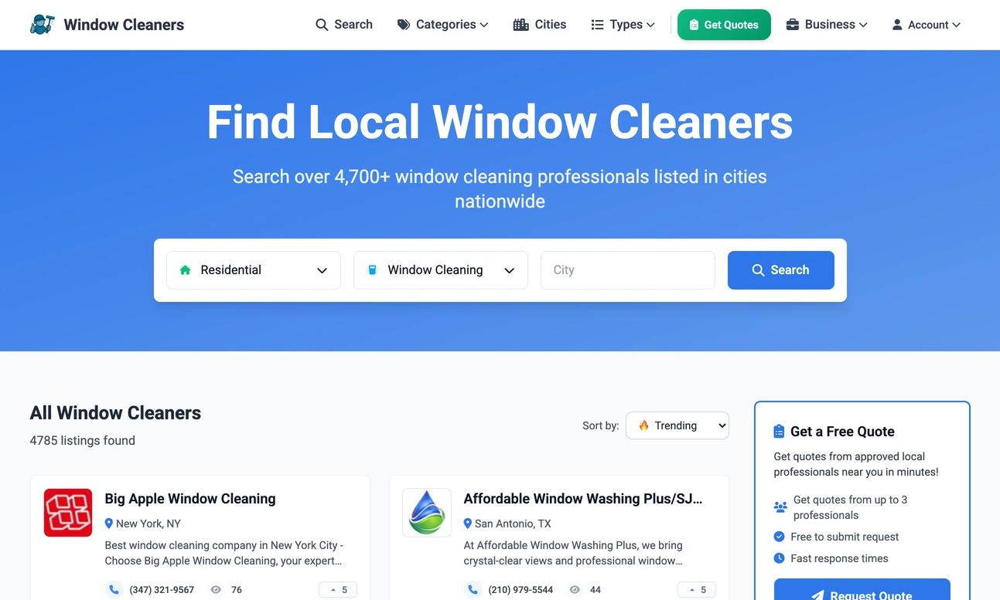</a></td>
  </tr>
  <tr>
    <td><a href="https://mobiledetailing.io">mobiledetailing.io</a> · Local Lab</td>
    <td><a href="https://usalocksmith.io">usalocksmith.io</a> · Local Lab</td>
    <td><a href="https://www.windowcleaners.io">windowcleaners.io</a> · Local Lab</td>
  </tr>
  <tr>
    <td><a href="https://usaroofers.io">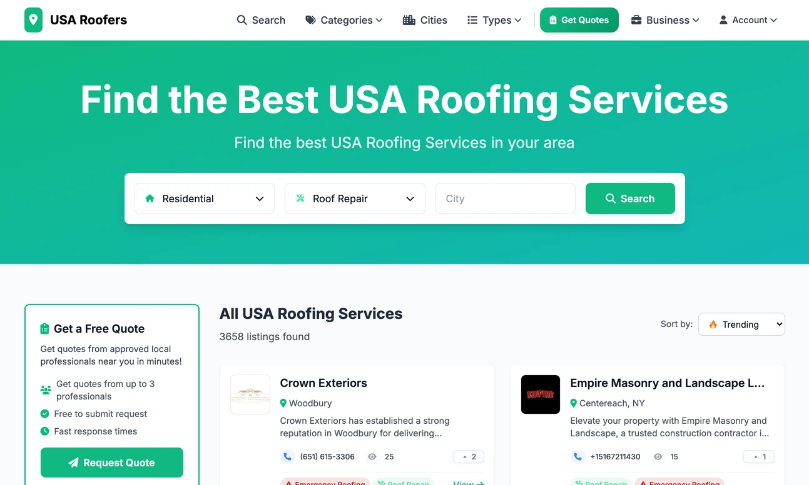</a></td>
    <td><a href="https://poolcleaners.io">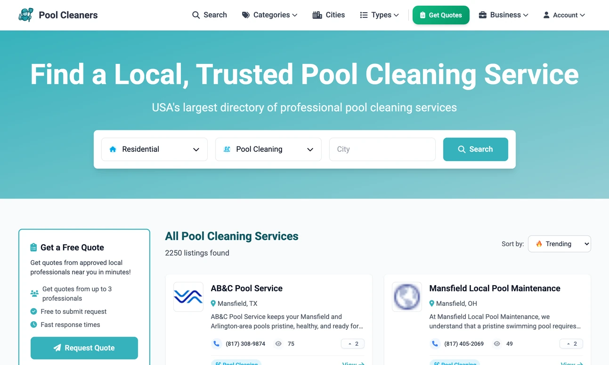</a></td>
    <td><a href="https://devremotely.com">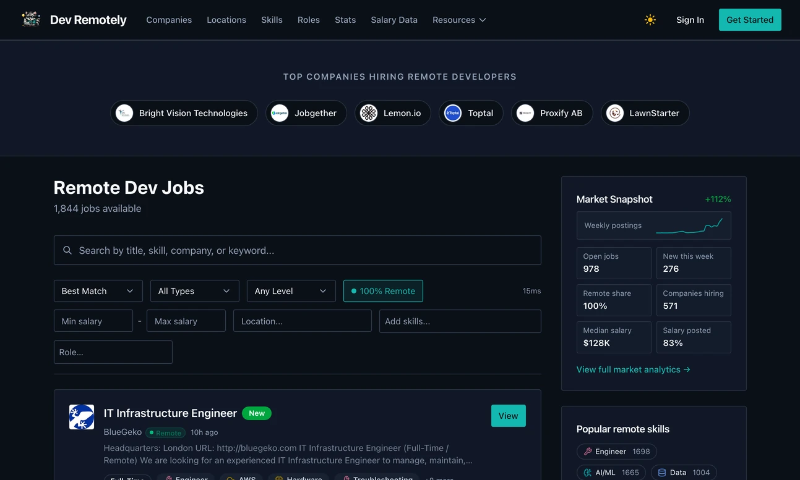</a></td>
  </tr>
  <tr>
    <td><a href="https://usaroofers.io">usaroofers.io</a> · Local Lab</td>
    <td><a href="https://poolcleaners.io">poolcleaners.io</a> · Local Lab</td>
    <td><a href="https://devremotely.com">devremotely.com</a> · Job Lab</td>
  </tr>
  <tr>
    <td><a href="https://skillfinder.io">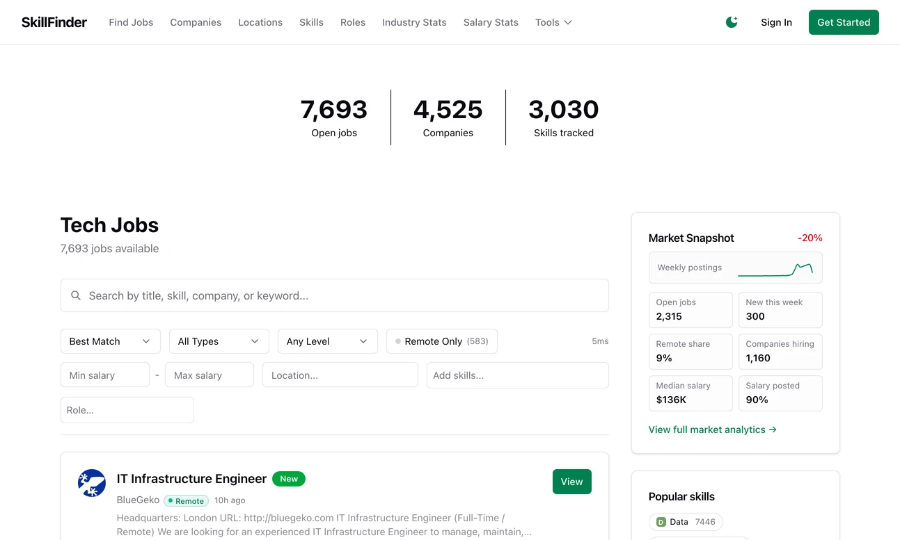</a></td>
    <td><a href="https://wireweek.io">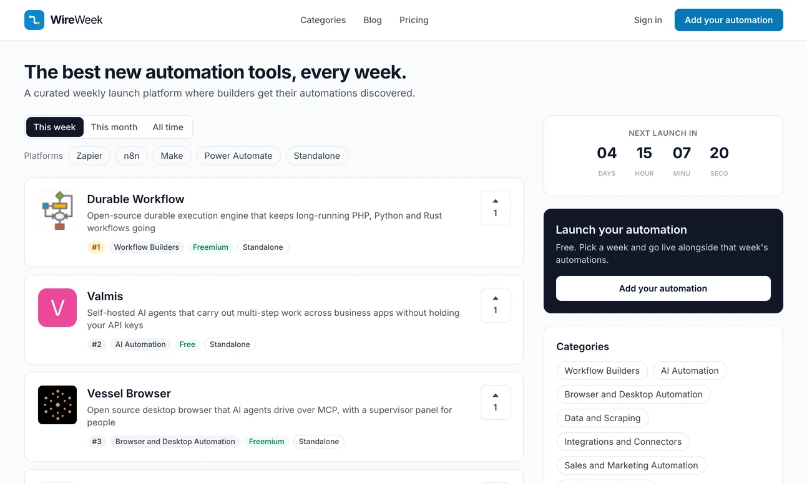</a></td>
    <td><a href="https://www.applauncher.io">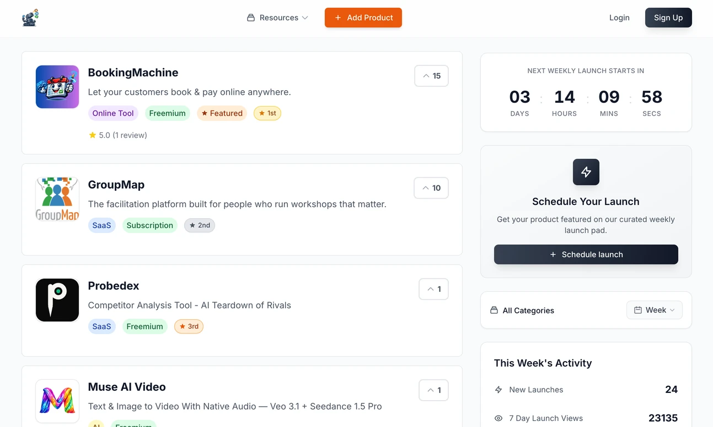</a></td>
  </tr>
  <tr>
    <td><a href="https://skillfinder.io">skillfinder.io</a> · Job Lab</td>
    <td><a href="https://wireweek.io">wireweek.io</a> · Launch Lab</td>
    <td><a href="https://www.applauncher.io">applauncher.io</a> · Launch Lab</td>
  </tr>
  <tr>
    <td><a href="https://biolaunch.io">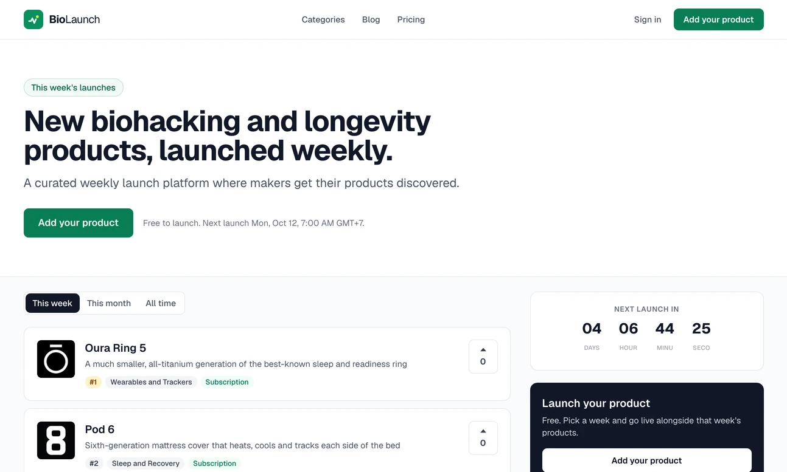</a></td>
    <td><a href="https://agentweek.io">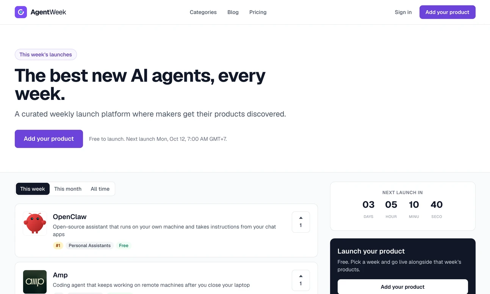</a></td>
    <td><a href="https://appsforstores.com">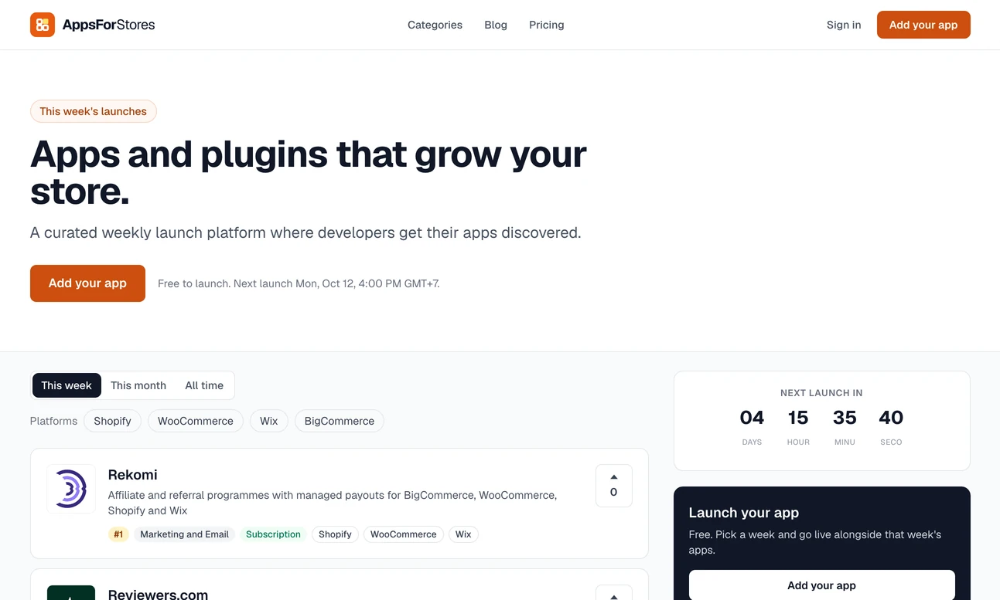</a></td>
  </tr>
  <tr>
    <td><a href="https://biolaunch.io">biolaunch.io</a> · Launch Lab</td>
    <td><a href="https://agentweek.io">agentweek.io</a> · Launch Lab</td>
    <td><a href="https://appsforstores.com">appsforstores.com</a> · Launch Lab</td>
  </tr>
</table>

## Pay once. Build as many as you like.

- One payment per kit, or one for all three. There is no monthly fee.
- Run unlimited sites you own. Rent them, sell them, or build them for clients.
- Professional and above get the private GitHub repository, so updates are a git pull.
- Thirty days to ask for a full refund.

Prices and tiers are on the [pricing page](https://directorylab.io/pricing).

## Questions

**What exactly do I get?** The complete, readable source code for the kit, its documentation, and the right to run as many sites with it as you like. Professional and above also get access to the private GitHub repository, so updates are a git pull.

**Can I sell a site I build?** Yes. You own every site you build and can run, rent or sell it, and build sites for clients. The one thing you cannot do is resell or publish the kit itself.

**Do I need to be a developer?** You need to be comfortable following a setup guide and using a command line. After that, a new site is configured in the admin panel, not in code.

**Why are the kits built on different stacks?** Each one uses what suited the job. Local Lab and Launch Lab are Python and Flask, which makes them cheap to host and easy to move. Job Lab is Next.js with a search engine and a job queue, because pulling in and searching thousands of jobs needs them.

More answers, and a form a real person reads, at [directorylab.io/contact](https://directorylab.io/contact).

 

  <a href="https://directorylab.io">directorylab.io</a> ·
  <a href="https://discord.gg/u9HHYwXmF">Discord</a> ·
  <a href="https://x.com/DirectoryLab">X</a> ·
  <a href="https://instagram.com/directory.lab">Instagram</a> ·
  <a href="https://www.youtube.com/@DirectoryLab">YouTube</a>

A <a href="https://dcblack.co.uk">DC Black</a> product, built by <a href="https://github.com/dcblack87">David Black</a>. 
© 2026 David Black. The kits are commercial software. Every admin screenshot and film on this page is of a demo site filled with made-up businesses and numbers.

