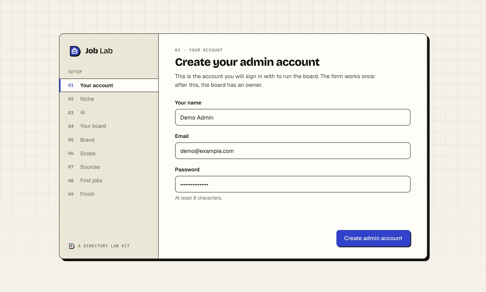
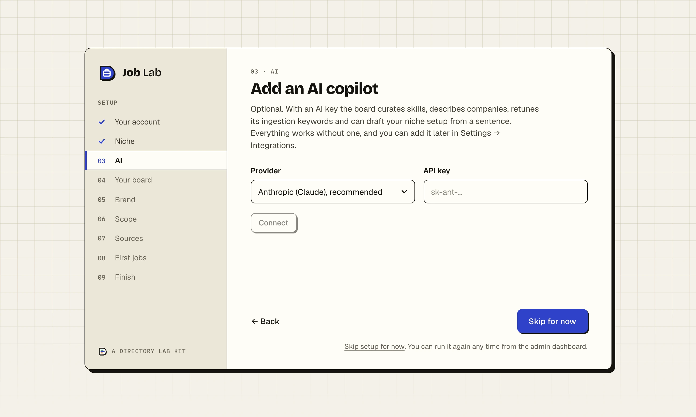
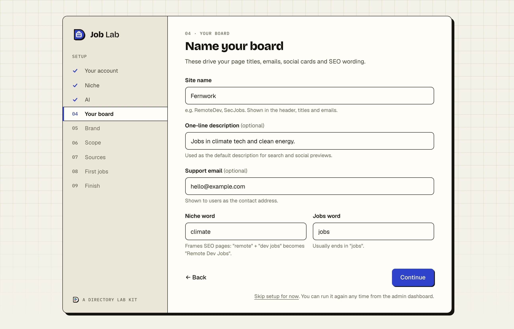
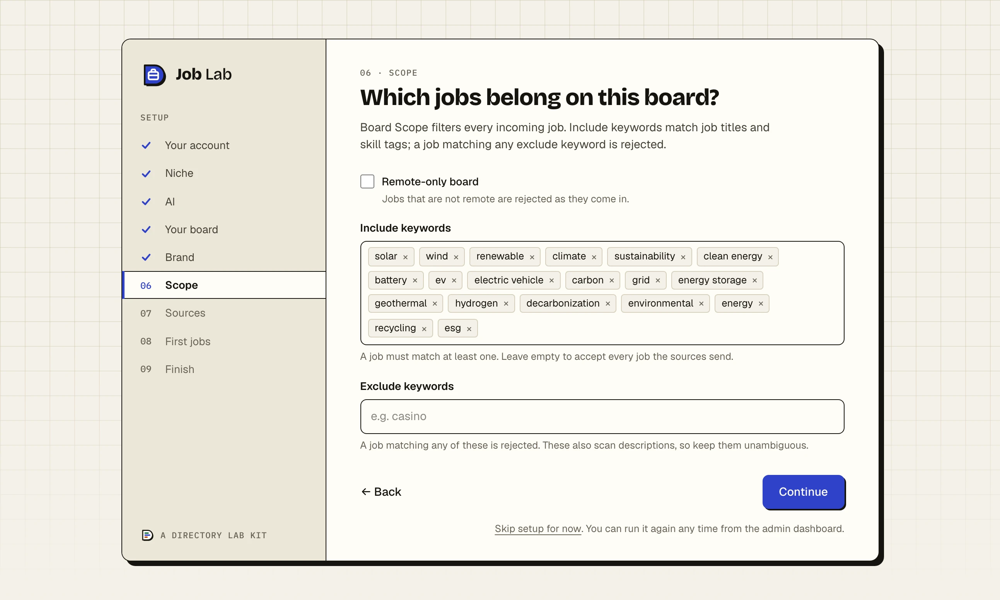
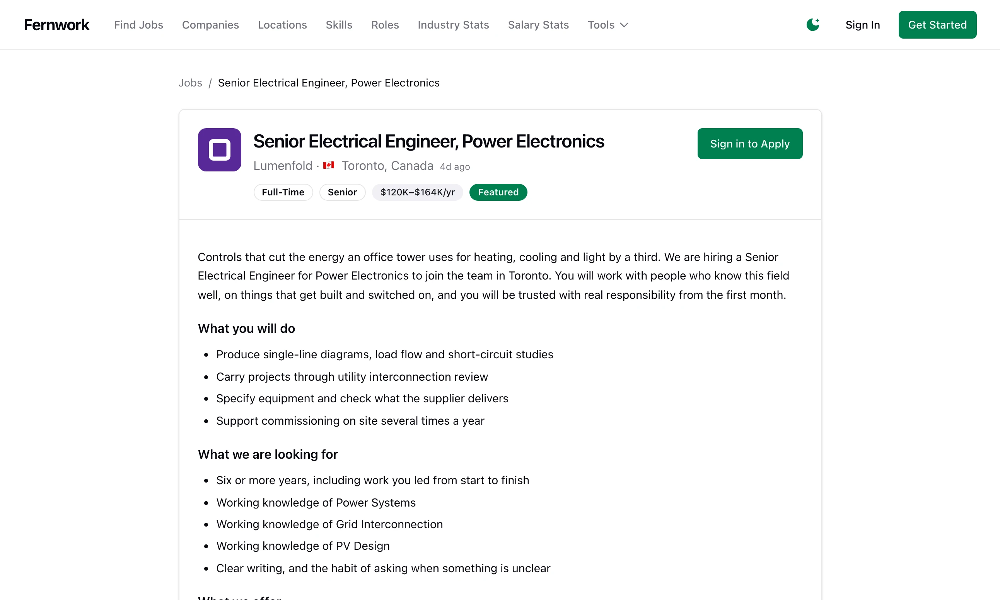
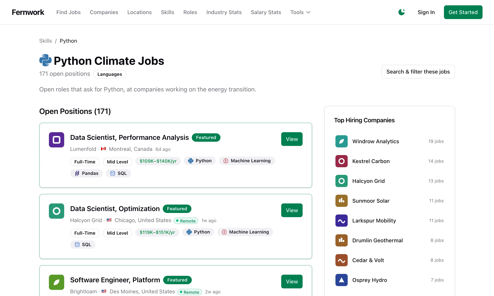
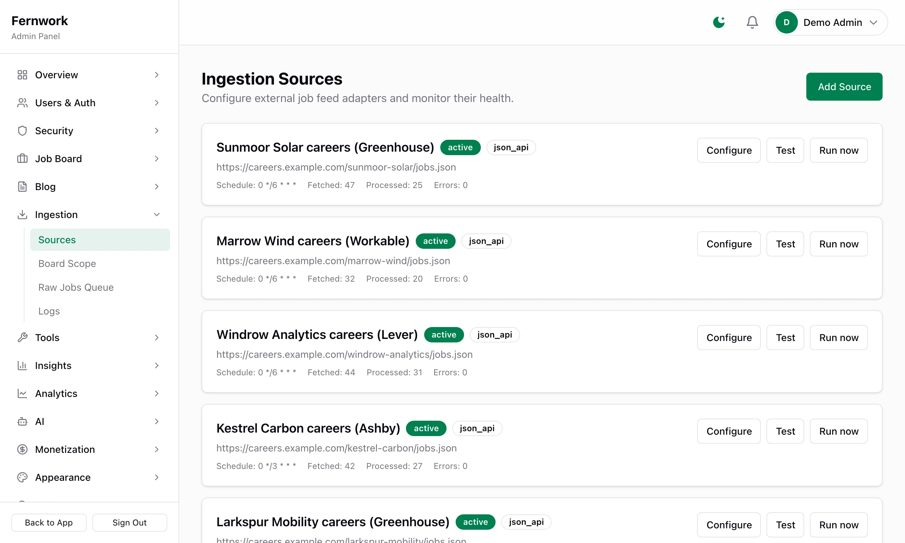
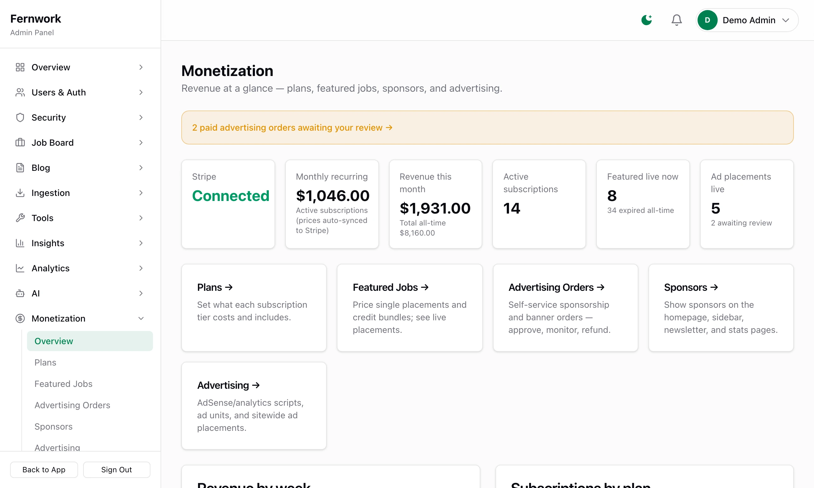
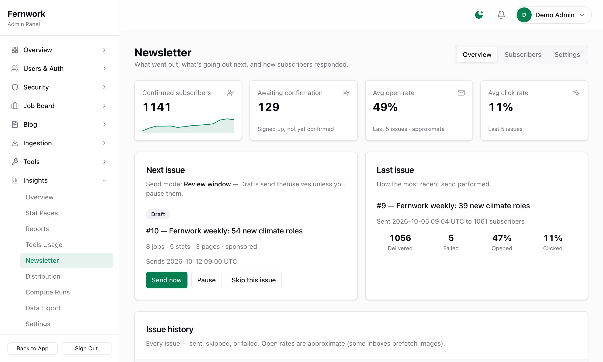

<h1 align="center">Job Lab</h1>

<strong>A niche job board that fills itself and runs itself.</strong>

  <a href="https://directorylab.io/job-lab">Kit page</a> ·
  <a href="https://directorylab.io/docs/job-lab">Docs</a> ·
  <a href="https://directorylab.io/pricing">Pricing</a> ·
  <a href="../README.md">Back to the tour</a>

Jobs arrive from feeds, job APIs and company hiring systems, filtered to your niche with the duplicates removed. A weekly newsletter assembles itself with sponsor slots. The AI tidies skills, roles and companies against a monthly cap. Docker on a single VPS; the included tooling runs several boards side by side on one server. It runs devremotely.com and skillfinder.io today.

Every admin screen below is from a demo board called Fernwork, filled with made-up companies and numbers. Nothing here is a mock-up.

## The setup wizard, step by step

A new install opens on the first-run form, then walks nine steps: the niche, an optional AI key, the board's name and words, the brand, the scope, the sources, the first jobs, the headline, and a list of what is connected. It shows once.

<table>
  <tr>
    <td width="50%"></td>
    <td width="50%"></td>
  </tr>
  <tr>
    <td>A new install opens on this form. It works once.</td>
    <td>The setup wizard starts from a niche: eleven starter packs, or a blank board.</td>
  </tr>
  <tr>
    <td></td>
    <td></td>
  </tr>
  <tr>
    <td>An AI key is optional. Skip for now moves on without one.</td>
    <td>Name the board and set the words its pages are built from.</td>
  </tr>
  <tr>
    <td></td>
    <td></td>
  </tr>
  <tr>
    <td>A colour, corners, type and an optional logo. All of it can be changed later.</td>
    <td>Board Scope decides which incoming jobs are kept.</td>
  </tr>
  <tr>
    <td></td>
    <td></td>
  </tr>
  <tr>
    <td>Tick the sources to start with. More can be added in the admin.</td>
    <td>The wizard fetches from each source while you watch.</td>
  </tr>
  <tr>
    <td></td>
    <td></td>
  </tr>
  <tr>
    <td>The last step sets the first words a visitor reads.</td>
    <td>Setup ends on a list of what is connected and what is not yet.</td>
  </tr>
</table>

Guide: [The setup wizard, step by step](https://directorylab.io/docs/job-lab/setup-wizard).

## See it running

<table>
  <tr>
    <td width="50%"></td>
    <td width="50%"></td>
  </tr>
  <tr>
    <td>The home page of a job board built with Job Lab.</td>
    <td>A job page.</td>
  </tr>
  <tr>
    <td></td>
    <td></td>
  </tr>
  <tr>
    <td>A skill page, one of the pages built for search engines.</td>
    <td>The admin control panel.</td>
  </tr>
  <tr>
    <td></td>
    <td></td>
  </tr>
  <tr>
    <td>Admin, Ingestion, Sources: where the jobs come from.</td>
    <td>Admin, Monetization: plans, featured jobs and ad orders in one place.</td>
  </tr>
  <tr>
    <td></td>
    <td></td>
  </tr>
  <tr>
    <td>The weekly newsletter drafts itself and waits for review.</td>
    <td></td>
  </tr>
</table>

## Four ways to charge, already built

- **Featured jobs and credit bundles.** Employers feature a listing for a fixed period, one-off or as a bundle of credits, through Stripe.
- **Employer plans.** Recurring plans with prices set in the admin and synced to Stripe.
- **Self-serve ad shop.** Sponsors book, pay, and wait for your approval. Rejected orders are refunded automatically.
- **Newsletter sponsorship.** Sell slots in the weekly email alongside site placements.

## What it does

- **Jobs arrive on their own.** Pulls from RSS and JSON feeds, job APIs and company hiring systems, then filters to your niche and removes duplicates.
- **A newsletter that writes itself.** Assembled weekly with sponsor slots, sent on review or on autopilot, with open and click tracking.
- **AI with a budget.** Daily tidying of skills, roles and companies, spam flagging and source tuning, with every call costed against a monthly cap.
- **Eleven niche starter packs.** Sources, filters and wording are set when you pick a niche in the wizard.
- **Built to rank.** Landing pages for skills, roles and locations, with Google Jobs structured data.
- **A real admin.** A homepage builder, moderation, revenue and health monitoring, and the sources, queues and search index in view.

## Wired in

| Part | What it does |
|---|---|
| Next.js 15 | App Router, React 19, TypeScript |
| Tailwind | Runtime theming, dark mode |
| Stripe | Subscriptions, one-off featured, webhook, customer portal |
| Auth.js | Google sign-in, email and password, force sign-out |
| Email | Any SMTP, 31 templates, SPF/DKIM/DMARC checks, newsletter |
| PostgreSQL | Drizzle, 18 migrations |
| Meilisearch | Typo-tolerant search, Postgres fallback |
| Redis | BullMQ workers, 23 scheduled tasks |
| Claude | Curation, spam checks, cost tracking (or OpenAI, Ollama) |
| Job feeds | RSS, Adzuna, Remotive, Greenhouse, Lever, Ashby |
| Google Analytics | GA4, Search Console, Indexing API |
| Telegram | Alerts, 16 commands |
| Docker + nginx | Cloudflare certs, backups, new-site script |
| Sentry | Or self-hosted GlitchTip |

And the rest: sitemap, JobPosting JSON-LD, OG images, programmatic landing pages, legal pages, encrypted keys, rate limits, lockout, security headers.

## The guides

Every guide was written from the code and checked on a fresh copy of each release. All of them are free to read.

**Start here**
[What Job Lab is](https://directorylab.io/docs/job-lab/what-is-job-lab) ·
[Install](https://directorylab.io/docs/job-lab/install) ·
[Setup wizard](https://directorylab.io/docs/job-lab/setup-wizard) ·
[Admin tour](https://directorylab.io/docs/job-lab/admin-tour) ·
[Make it your niche](https://directorylab.io/docs/job-lab/make-it-your-niche)

**Fill the board**
[Job sources](https://directorylab.io/docs/job-lab/job-sources) ·
[Company feeds](https://directorylab.io/docs/job-lab/company-feeds) ·
[Board scope](https://directorylab.io/docs/job-lab/board-scope) ·
[Skills, roles and locations](https://directorylab.io/docs/job-lab/skills-roles-locations) ·
[AI](https://directorylab.io/docs/job-lab/ai) ·
[Employers and moderation](https://directorylab.io/docs/job-lab/employers-and-moderation)

**Earn**
[Connect Stripe](https://directorylab.io/docs/job-lab/stripe-setup) ·
[Employer plans](https://directorylab.io/docs/job-lab/employer-plans) ·
[Featured jobs](https://directorylab.io/docs/job-lab/featured-jobs) ·
[Advertising shop](https://directorylab.io/docs/job-lab/advertising) ·
[Sponsors and ads](https://directorylab.io/docs/job-lab/sponsors-and-ads)

**Grow**
[Email](https://directorylab.io/docs/job-lab/email) ·
[Newsletter](https://directorylab.io/docs/job-lab/newsletter) ·
[SEO](https://directorylab.io/docs/job-lab/seo) ·
[Stats, blog and embeds](https://directorylab.io/docs/job-lab/stats-and-blog) ·
[Telegram and Google sign-in](https://directorylab.io/docs/job-lab/telegram-and-sign-in)

**Go live**
[Deploy](https://directorylab.io/docs/job-lab/deploy) ·
[Backups and health](https://directorylab.io/docs/job-lab/backups-and-health)

**Keep it running**
[Updating](https://directorylab.io/docs/job-lab/updating) ·
[Troubleshooting](https://directorylab.io/docs/job-lab/troubleshooting)

## Built with it

[devremotely.com](https://devremotely.com), remote developer jobs ·
[skillfinder.io](https://skillfinder.io), jobs by skill

## Tiers

- **Starter.** Just the code: the full source as a download, every revenue stream, unlimited sites you own, and the documentation. No updates and no support.
- **Professional.** Everything in Starter, plus the private GitHub repository, updates for life by git pull, the buyers' community and email support.
- **Enterprise.** Everything in Professional, plus the tooling for running several boards on one server, priority support and a 30 minute one-to-one setup call.

What each tier adds for this kit, and the prices, are on the [kit page](https://directorylab.io/job-lab#tiers).
