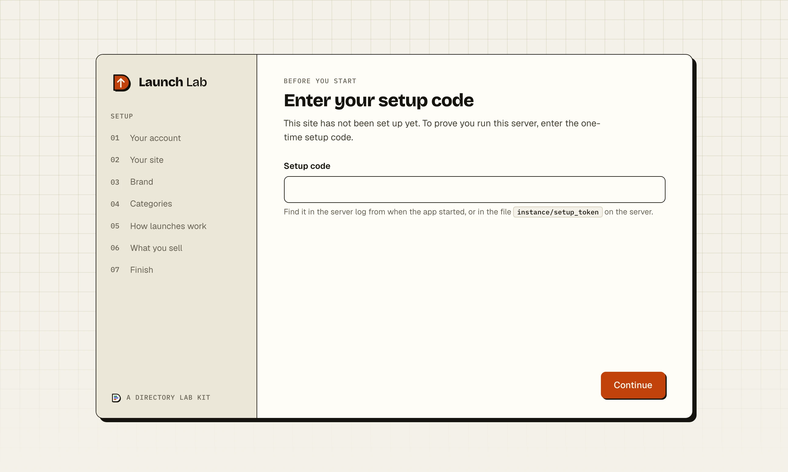
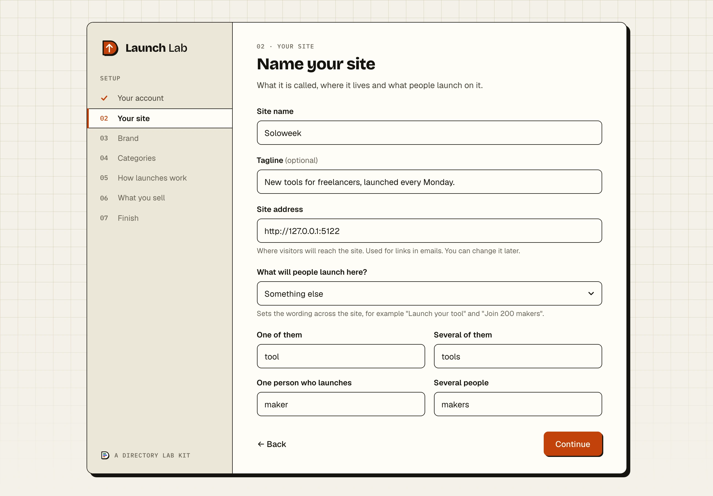
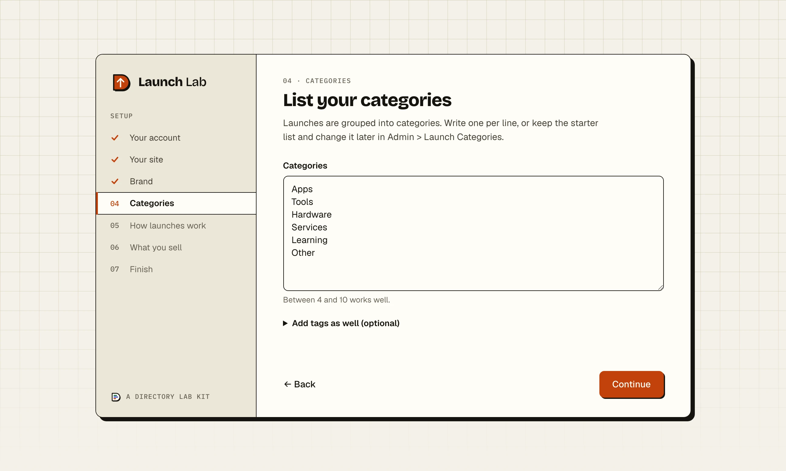
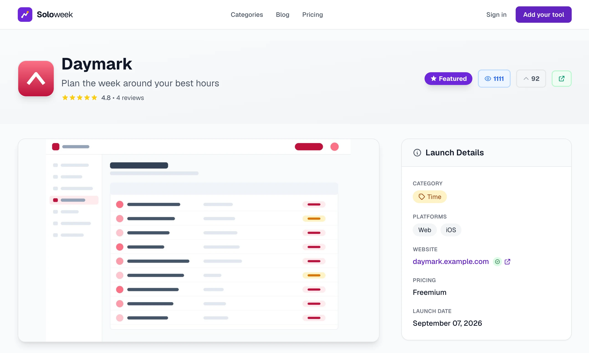
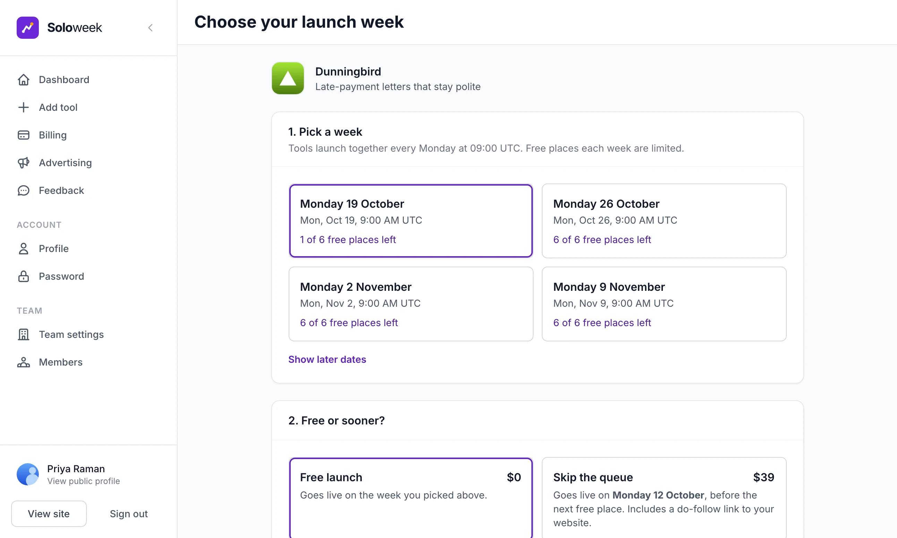
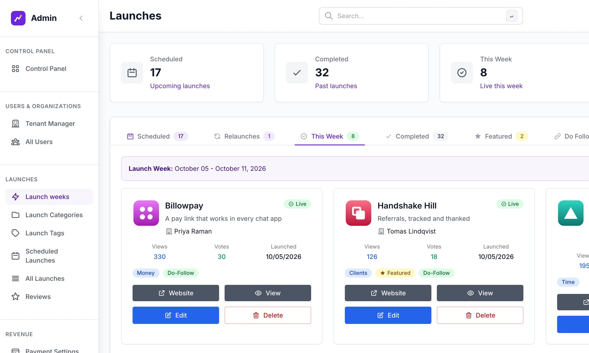
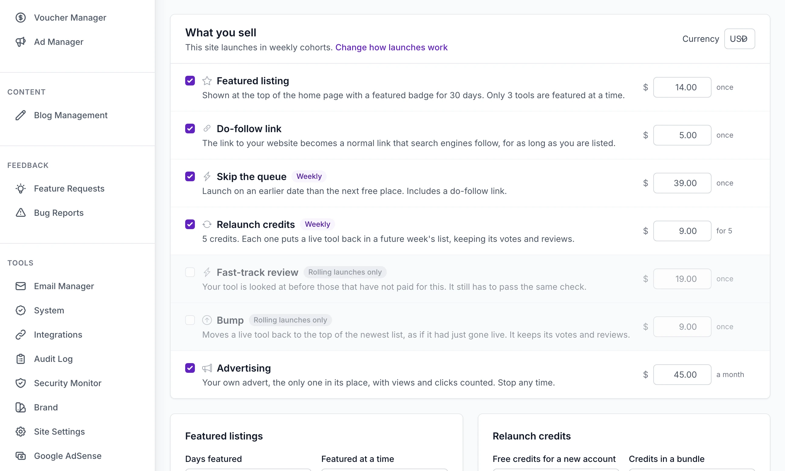
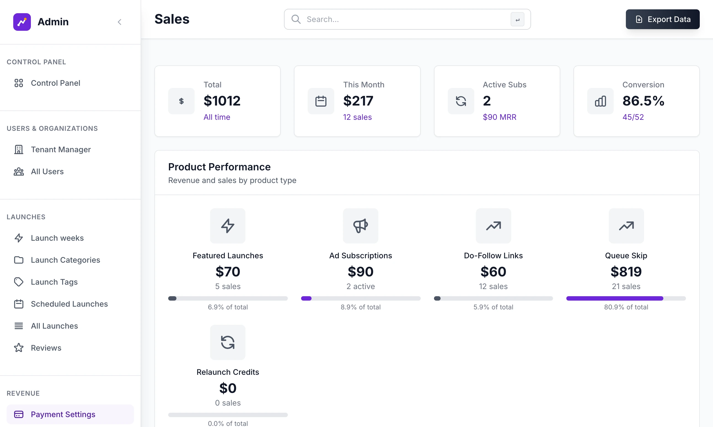

<h1 align="center">Launch Lab</h1>

<strong>A weekly launch platform for any niche, in the style of Product Hunt.</strong>

  <a href="https://directorylab.io/launch-lab">Kit page</a> ·
  <a href="https://directorylab.io/docs/launch-lab">Docs</a> ·
  <a href="https://directorylab.io/pricing">Pricing</a> ·
  <a href="../README.md">Back to the tour</a>

You set the launch day, the hour, and how many free and paid places each week has. Makers list a product, pick a week, share it and watch the votes. One brand colour in the admin generates the whole palette. Docker with automatic HTTPS, or any Python host; one server can run many launch sites.

Every admin screen below is from a demo site called Soloweek, filled with made-up products and numbers. Nothing here is a mock-up.

## The setup wizard, step by step

A new install opens on a wizard in seven panels: the admin account, the site and its words, a colour and a look, the categories, how launches work, what you sell, and a summary that reads it all back before it creates the site. On a server it asks for a one-time setup code first. It shows once.

<table>
  <tr>
    <td width="50%"></td>
    <td width="50%"></td>
  </tr>
  <tr>
    <td>On a server the wizard asks for the one-time setup code first.</td>
    <td>The setup wizard opens on the admin account. It is shown once, on a new install.</td>
  </tr>
  <tr>
    <td></td>
    <td></td>
  </tr>
  <tr>
    <td>Step two names the site and sets the words it uses.</td>
    <td>Pick a colour and a look in the wizard; both can be changed later.</td>
  </tr>
  <tr>
    <td></td>
    <td></td>
  </tr>
  <tr>
    <td>Categories go in one to a line. Tags are optional.</td>
    <td>Choose weekly cohorts or rolling launches, and how many places a week has.</td>
  </tr>
  <tr>
    <td></td>
    <td></td>
  </tr>
  <tr>
    <td>Tick what you want to sell and set each price.</td>
    <td>The last step reads your choices back before it creates the site.</td>
  </tr>
  <tr>
    <td></td>
    <td></td>
  </tr>
  <tr>
    <td>A new site lists what is left to set up, with a link to each.</td>
    <td></td>
  </tr>
</table>

Guide: [The setup wizard](https://directorylab.io/docs/launch-lab/setup-wizard).

## See it running

<table>
  <tr>
    <td width="50%"></td>
    <td width="50%"></td>
  </tr>
  <tr>
    <td>The home page of a launch site built with Launch Lab.</td>
    <td>Every listing gets its own page.</td>
  </tr>
  <tr>
    <td></td>
    <td></td>
  </tr>
  <tr>
    <td>A maker picks the week to launch in. A paid place skips the queue.</td>
    <td>Admin, Control Panel.</td>
  </tr>
  <tr>
    <td></td>
    <td></td>
  </tr>
  <tr>
    <td>This week's launches.</td>
    <td>Every price, and whether it is on sale, is set on one page.</td>
  </tr>
  <tr>
    <td></td>
    <td></td>
  </tr>
  <tr>
    <td>Admin, Payment Settings: what has been earned, by product.</td>
    <td></td>
  </tr>
</table>

## Four ways to charge, already built

- **Skip the queue.** Makers pay to launch in the week they want instead of waiting for a free place.
- **Featured listings.** A limited number of featured positions, sold for a fixed period.
- **Advertising.** Sponsor placements with their own editor and stats.
- **Links and relaunches.** Paid do-follow links and relaunch credit bundles, with vouchers and refunds handled in the admin.

## What it does

- **A weekly launch rhythm.** You set the launch day, the hour, and how many free and paid places each week has. Rolling launches are the other mode.
- **A maker journey people finish.** A four-step listing editor with live preview, a week picker, a share kit, and per-launch analytics.
- **One colour themes the site.** Pick a brand colour in the admin and the whole palette is generated from it, in four looks.
- **Set up in the browser.** The wizard above, with email, Stripe and Google sign-in entered in the admin afterwards.
- **Niche packs.** Load categories, wording and starter listings for a niche from a folder of files.
- **Email built in.** Campaigns, templates and automations.

## Wired in

| Part | What it does |
|---|---|
| Flask | 10 blueprints, Gunicorn |
| Tailwind | One colour becomes the palette, 4 looks |
| Stripe | 7 products set in the admin, webhook, vouchers, refunds |
| Google sign-in | OpenID Connect, verified email |
| Cloudflare Turnstile | Sign-up, sign-in, reviews, contact |
| Email | Any SMTP, 25 emails, campaigns, automations |
| PostgreSQL | Or SQLite, migrations run at start |
| Docker + Caddy | Automatic HTTPS, or nginx for many sites |
| Backups | Daily, weekly, monthly, rollback on a failed deploy |
| Google Analytics | GA4, AdSense |
| Telegram | Backup alerts |

And the rest: sitemap, JSON-LD, a share image per launch, RSS, CSRF, CSP headers, legal pages, 124 tests.

## The guides

Every guide was written from the code and checked on a fresh copy of each release. All of them are free to read.

**Start here**
[What Launch Lab is](https://directorylab.io/docs/launch-lab/what-is-launch-lab) ·
[Install](https://directorylab.io/docs/launch-lab/install) ·
[Setup wizard](https://directorylab.io/docs/launch-lab/setup-wizard) ·
[Admin tour](https://directorylab.io/docs/launch-lab/admin-tour) ·
[How launches work](https://directorylab.io/docs/launch-lab/how-launches-work)

**Fill the site**
[Make it your niche](https://directorylab.io/docs/launch-lab/make-it-your-niche) ·
[Niche packs](https://directorylab.io/docs/launch-lab/niche-packs) ·
[Brand and looks](https://directorylab.io/docs/launch-lab/brand-and-looks) ·
[What a maker sees](https://directorylab.io/docs/launch-lab/makers) ·
[Running launches](https://directorylab.io/docs/launch-lab/running-launches)

**Earn**
[Connect Stripe](https://directorylab.io/docs/launch-lab/stripe-setup) ·
[Products and prices](https://directorylab.io/docs/launch-lab/prices) ·
[Featured and vouchers](https://directorylab.io/docs/launch-lab/featured-and-vouchers) ·
[Advertising](https://directorylab.io/docs/launch-lab/advertising) ·
[Sales and refunds](https://directorylab.io/docs/launch-lab/sales-and-refunds)

**Grow**
[Email](https://directorylab.io/docs/launch-lab/email) ·
[Campaigns and automations](https://directorylab.io/docs/launch-lab/campaigns-and-automations) ·
[Sign-in and bot protection](https://directorylab.io/docs/launch-lab/sign-in-and-bot-protection) ·
[Blog, SEO and sharing](https://directorylab.io/docs/launch-lab/blog-seo-and-sharing)

**Go live**
[Deploy](https://directorylab.io/docs/launch-lab/deploy) ·
[Opening day](https://directorylab.io/docs/launch-lab/opening-day) ·
[Backups and jobs](https://directorylab.io/docs/launch-lab/backups-and-jobs)

**Keep it running**
[Updating](https://directorylab.io/docs/launch-lab/updating) ·
[Troubleshooting](https://directorylab.io/docs/launch-lab/troubleshooting)

## Built with it

[wireweek.io](https://wireweek.io) ·
[applauncher.io](https://www.applauncher.io) ·
[biolaunch.io](https://biolaunch.io) ·
[agentweek.io](https://agentweek.io) ·
[appsforstores.com](https://appsforstores.com)

## Tiers

- **Starter.** Just the code: the full source as a download, every revenue stream, unlimited sites you own, and the documentation. No updates and no support.
- **Professional.** Everything in Starter, plus the private GitHub repository, updates for life by git pull, the buyers' community and email support.
- **Enterprise.** Everything in Professional, plus the multi-site deploy script, help building your first niche pack, priority support and a 30 minute one-to-one setup call.

What each tier adds for this kit, and the prices, are on the [kit page](https://directorylab.io/launch-lab#tiers).
