
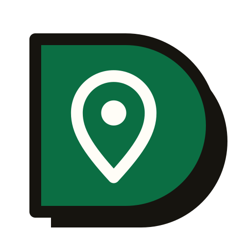

<h1 align="center">Local Lab</h1>

<strong>Local service directories with the revenue already wired in.</strong>

  <a href="https://directorylab.io/local-lab">Kit page</a> ·
  <a href="https://directorylab.io/docs/local-lab">Docs</a> ·
  <a href="https://directorylab.io/pricing">Pricing</a> ·
  <a href="../README.md">Back to the tour</a>

The codebase behind real directories for detailers, locksmiths, roofers, pool cleaners and window cleaners. One install becomes any local niche from the admin panel: import the businesses, set your prices, and every city you add is a new page and a new thing to sell. Runs on a $5 a month host. Starts on SQLite with no setup and moves to PostgreSQL when you grow.

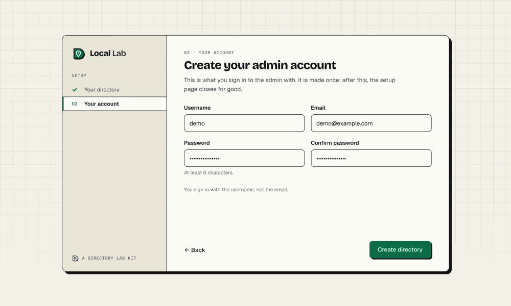

Every admin screen below is from a demo directory called Greenkeep, filled with made-up businesses and numbers. Nothing here is a mock-up.

## The setup wizard, step by step

A new install opens on a two-step wizard. It asks for the directory, then the admin account, and lands on the dashboard. It shows once.

<table>
  <tr>
    <td width="50%">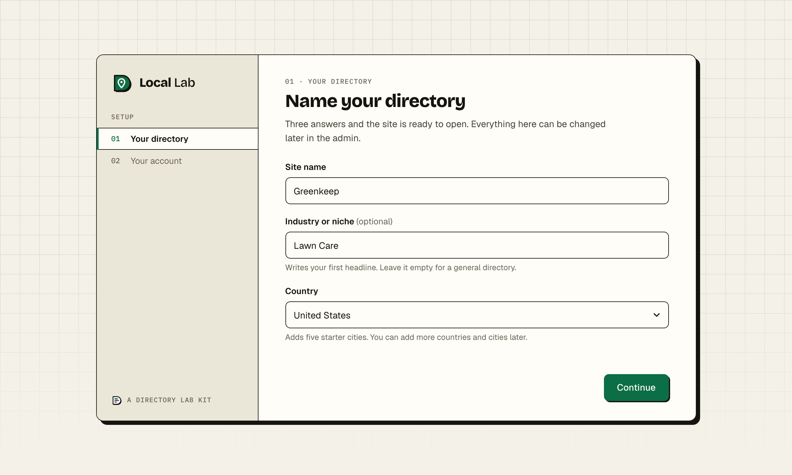</td>
    <td width="50%">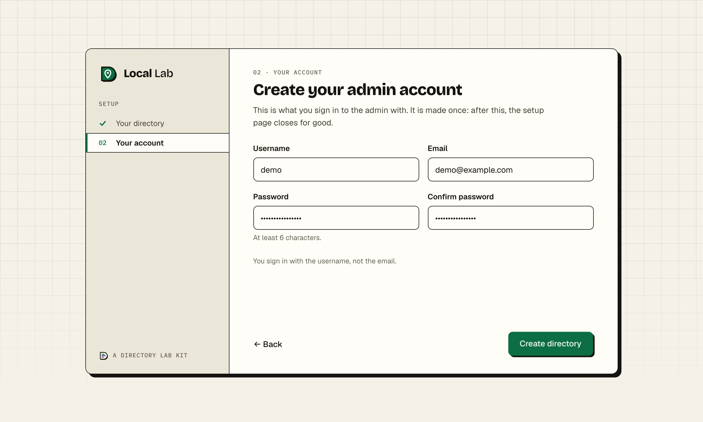</td>
  </tr>
  <tr>
    <td>The setup wizard, shown once on a new install.</td>
    <td>The second step makes the admin account.</td>
  </tr>
</table>

Guide: [Install Local Lab on your computer](https://directorylab.io/docs/local-lab/install).

## See it running

<table>
  <tr>
    <td width="50%">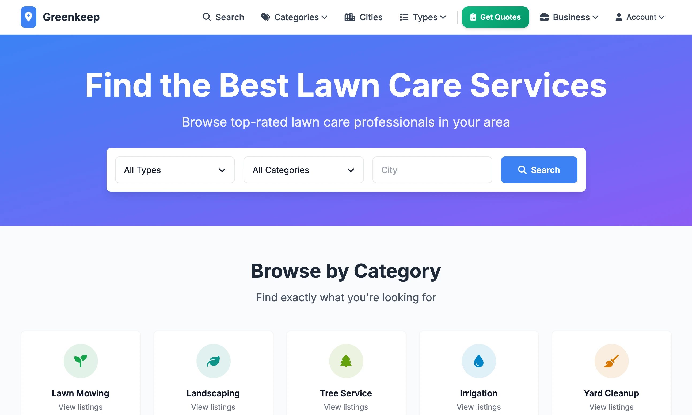</td>
    <td width="50%">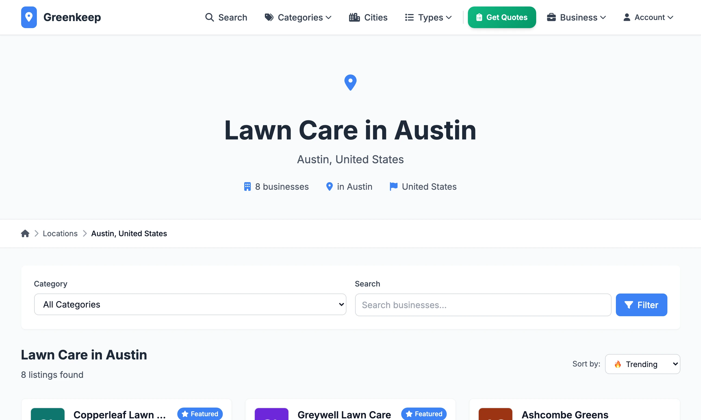</td>
  </tr>
  <tr>
    <td>The home page of a directory built with Local Lab.</td>
    <td>Every city with listings gets its own page.</td>
  </tr>
  <tr>
    <td>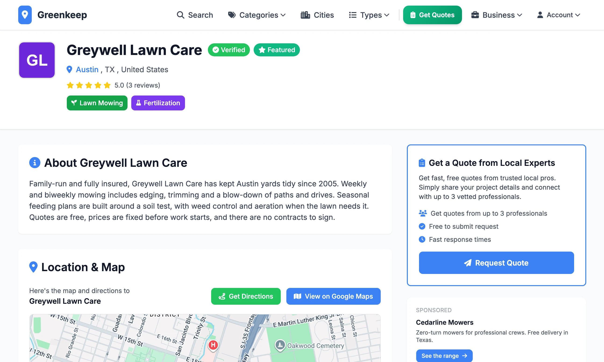</td>
    <td>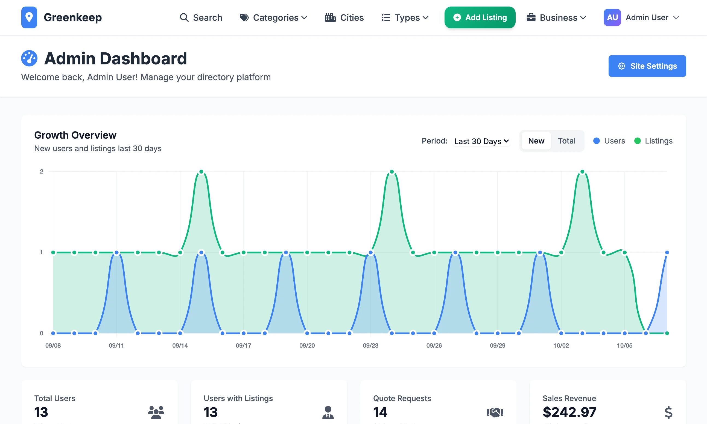</td>
  </tr>
  <tr>
    <td>A business page, built from one row of the import file.</td>
    <td>The admin dashboard.</td>
  </tr>
  <tr>
    <td>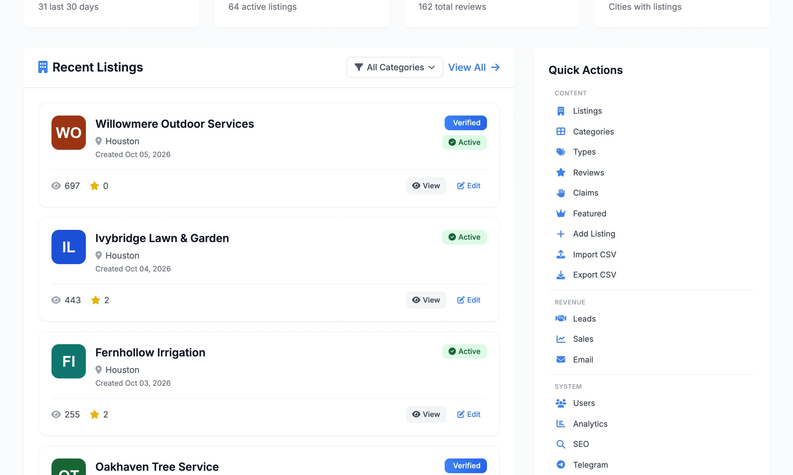</td>
    <td>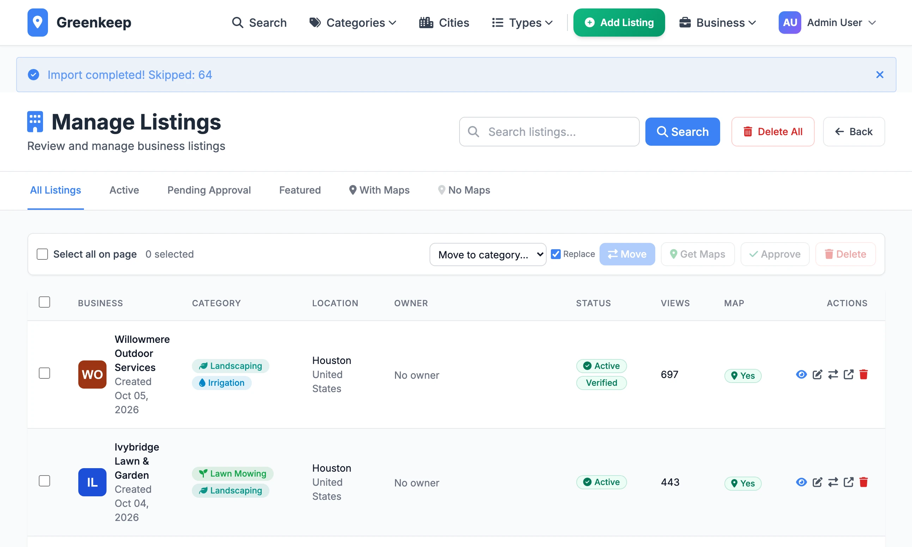</td>
  </tr>
  <tr>
    <td>Quick Actions on the dashboard is the menu for every admin screen.</td>
    <td>After an import you land on Listings with the result across the top.</td>
  </tr>
  <tr>
    <td>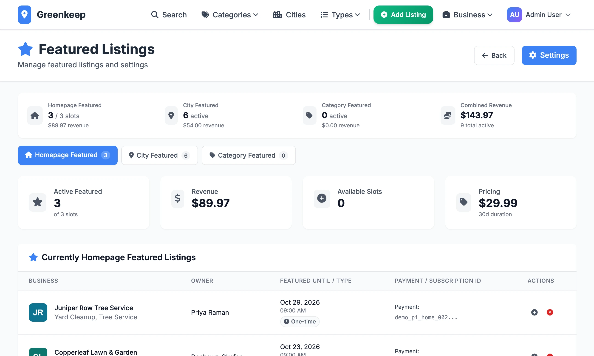</td>
    <td>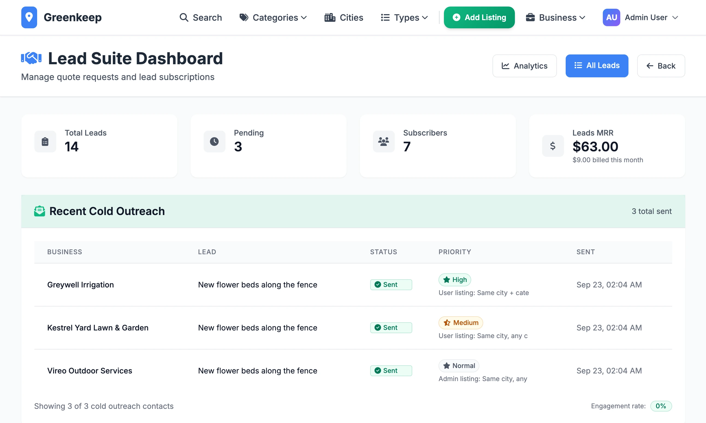</td>
  </tr>
  <tr>
    <td>Admin, Featured: three paid placements, home page, city and category.</td>
    <td>Admin, Leads: quote requests and the businesses paying to receive them.</td>
  </tr>
</table>

## Four ways to charge, already built

- **Lead marketplace.** Customers request quotes for free. Businesses pay monthly per city to receive them, with a limited number of places per city.
- **Homepage featured listings.** One-off or monthly, with limited slots, paid through Stripe and expired automatically.
- **City and category sponsorship.** Businesses pay to appear at the top of their own city or category page.
- **Ad slots.** AdSense placements built into the layouts, so income can start from the first visitor.

## What it does

- **Fill a city in minutes.** The Google Places importer finds businesses for any city and category. CSV import handles thousands of rows with duplicate detection.
- **A page for every city and service.** City, category and "near me" pages are generated from your data, with sitemaps and structured data.
- **AI clean-up.** Claude rewrites scraped descriptions and writes selling points before import.
- **No code between niches.** Name, logo, colours, categories, pricing and email templates are admin settings.
- **Outreach that runs itself.** Automated email with bounce handling, and cold outreach when a city has leads but no subscriber.
- **Run it from your phone.** A Telegram bot sends new listings, claims and payments with one-tap approve buttons.

## Wired in

| Part | What it does |
|---|---|
| Flask | Python 3.11, Gunicorn, about 120 admin routes |
| Tailwind | Colours and fonts themed from the admin |
| Stripe | Checkout, subscriptions, webhooks, refunds ledger |
| Google sign-in | One click, verified email, password reset |
| Email | Any SMTP, 26 emails, campaigns, bounce handling |
| reCAPTCHA | Register, forgot password, contact |
| Claude | Rewrites descriptions, writes selling points |
| Google Places | Scrape businesses by city, import-ready CSV |
| Geocoding | OpenCage, map embeds, directions |
| PostgreSQL | Or SQLite, 36 migrations |
| Docker + nginx | HTTPS, multi-site deploy, nightly backups |
| Telegram | Alerts, approve listings from your phone |
| Google Analytics | GA4 events, AdSense slots |

And the rest: sitemap and robots, LocalBusiness JSON-LD, OG tags, rate limits, CSRF, legal pages, branded error pages.

## The guides

Every guide was written from the code and checked on a fresh copy of each release. All of them are free to read.

**Start here**
[What Local Lab is](https://directorylab.io/docs/local-lab/what-is-local-lab) ·
[Install](https://directorylab.io/docs/local-lab/install) ·
[Admin tour](https://directorylab.io/docs/local-lab/admin-tour) ·
[Make it your niche](https://directorylab.io/docs/local-lab/make-it-your-niche)

**Fill the directory**
[The data pipeline](https://directorylab.io/docs/local-lab/data-pipeline) ·
[Google Places](https://directorylab.io/docs/local-lab/google-places-scraper) ·
[Claude clean-up](https://directorylab.io/docs/local-lab/claude-clean-up) ·
[Import a CSV](https://directorylab.io/docs/local-lab/import-csv) ·
[Cities and map pins](https://directorylab.io/docs/local-lab/cities-and-geocoding) ·
[Listings and claims](https://directorylab.io/docs/local-lab/listings-and-claims)

**Earn**
[Connect Stripe](https://directorylab.io/docs/local-lab/stripe-setup) ·
[Featured listings](https://directorylab.io/docs/local-lab/featured-listings) ·
[Sell leads](https://directorylab.io/docs/local-lab/sell-leads) ·
[Ads](https://directorylab.io/docs/local-lab/ads)

**Grow**
[SEO](https://directorylab.io/docs/local-lab/seo) ·
[Email, campaigns and bounces](https://directorylab.io/docs/local-lab/email-campaigns) ·
[Cold outreach](https://directorylab.io/docs/local-lab/cold-outreach) ·
[Telegram and sign-in](https://directorylab.io/docs/local-lab/telegram-and-sign-in)

**Go live**
[Deploy](https://directorylab.io/docs/local-lab/deploy) ·
[Domains and HTTPS](https://directorylab.io/docs/local-lab/domains-and-https) ·
[Backups and PostgreSQL](https://directorylab.io/docs/local-lab/backups-and-postgresql)

**Keep it running**
[Updating](https://directorylab.io/docs/local-lab/updating) ·
[Troubleshooting](https://directorylab.io/docs/local-lab/troubleshooting)

## Built with it

[mobiledetailing.io](https://mobiledetailing.io), mobile car detailers across the US ·
[usalocksmith.io](https://usalocksmith.io), a US locksmith directory ·
[windowcleaners.io](https://www.windowcleaners.io), window cleaning companies by city ·
[usaroofers.io](https://usaroofers.io), roofing contractors across the US ·
[poolcleaners.io](https://poolcleaners.io), pool cleaning and maintenance services

## Tiers

- **Starter.** Just the code: the full source as a download, every revenue stream, unlimited sites you own, and the documentation. No updates and no support.
- **Professional.** Everything in Starter, plus the private GitHub repository, updates for life by git pull, the buyers' community and email support.
- **Enterprise.** Everything in Professional, plus the tooling for running a portfolio of sites, priority support and a 30 minute one-to-one setup call.

What each tier adds for this kit, and the prices, are on the [kit page](https://directorylab.io/local-lab#tiers).
